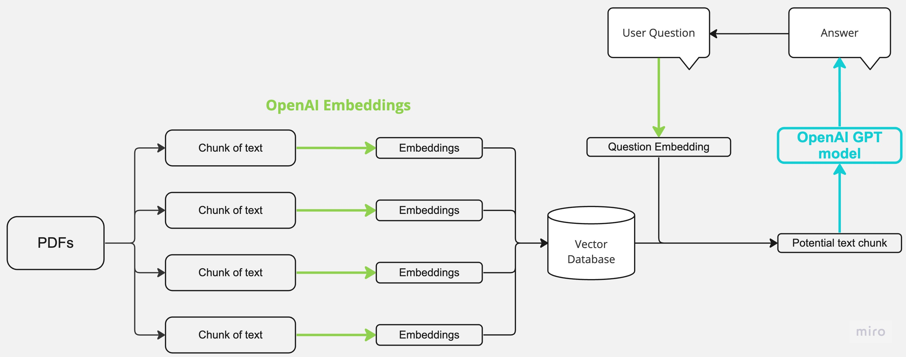

# Custom Q&A Chatbot (RAG)

A local PDF question-answering chatbot built with Streamlit, LangChain, FAISS and Ollama. Nothing leaves your machine: embeddings come from `nomic-embed-text` and answers from `llama3.2`, both served by Ollama.



## How it works

1. **Load**: each PDF is read page by page, keeping the file name and page number as metadata.
2. **Chunk**: pages are split with a recursive character splitter (800 characters, 120 overlap).
3. **Embed and index**: chunks are embedded and stored in a FAISS index.
4. **Retrieve and answer**: the top 4 chunks are passed to the LLM through a conversational retrieval chain with chat memory. The app shows the source file and page for every answer.

| File | Purpose |
|---|---|
| `rag.py` | Loading, chunking, embedding, indexing, retrieval |
| `app.py` | Streamlit chat UI |
| `evaluate.py` | Retrieval evaluation |
| `eval/questions.json` | 32 questions with the PDF page that answers each |

## Setup

```bash
pip install -r requirements.txt
ollama pull llama3.2
ollama pull nomic-embed-text
streamlit run app.py
```

## Evaluation

`evaluate.py` measures retrieval on the 124-page ADS Circuit Design Cookbook included in this repo. Each of the 32 questions has a known answer page; a retrieval counts as a hit at k if any of the top-k chunks comes from that page. It reports hit@1, hit@4 and mean reciprocal rank for each embedder and chunk size.

```bash
python evaluate.py --embedders hash ollama --chunk-sizes 400 800 1600
```

`hash` is a bag-of-words hashing embedder that needs no model. It serves as the lexical baseline to compare `nomic-embed-text` against.

### Results

Run on 2026-11-25 (32 questions, top-4 retrieval, MacBook, Ollama `nomic-embed-text`):

| embedder | chunk_size | chunks | hit@1 | hit@4 | mrr | ms_per_query |
|---|---|---|---|---|---|---|
| hash | 400 | 890 | 0.656 | 0.781 | 0.711 | 0.3 |
| hash | 800 | 473 | 0.656 | 0.812 | 0.711 | 0.1 |
| hash | 1600 | 258 | 0.625 | 0.75 | 0.667 | 0.1 |
| ollama | 400 | 890 | 0.719 | 0.938 | 0.812 | 9.3 |
| ollama | 800 | 473 | 0.75 | 1.0 | 0.859 | 9.2 |
| ollama | 1600 | 258 | 0.688 | 0.906 | 0.766 | 10.1 |

- Semantic embeddings beat the lexical baseline at every chunk size. At 800 characters, `nomic-embed-text` puts a gold page in the top 4 for **all 32 questions** (hit@4 1.00 vs 0.81) and raises MRR from 0.71 to 0.86.
- 800-character chunks score best. Smaller chunks split the answers across chunks; larger ones dilute the embedding.
- Query latency is about 9 ms, which is the Ollama embedding call; FAISS search itself is under 1 ms.

## Author

Rafayel Mirijanyan
